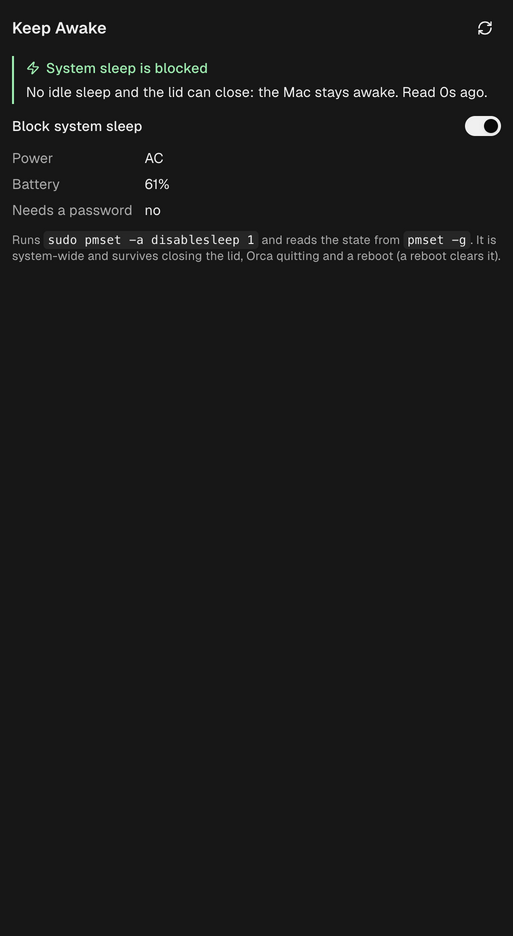

# Keep Awake — an Orca plugin

macOS sleeps. Agents don't want it to. **Keep Awake** puts the switch and the current state in
Orca: a sidebar panel, an always-visible status-bar item, a command, and `⌘⇧K`.




## What it does

- **Status bar item** — `⚡ Awake` while system sleep is blocked, `⏸ Sleep on` while it is allowed.
  Turns amber on battery. Click it to toggle. The tooltip carries the same state.
- **Panel** — the state, when it was read, the switch, power source and battery level, and a red
  warning if you leave sleep blocked on battery.
- **`Keep Awake: …` palette commands** — toggle, block, allow, refresh — and `⌘⇧K` to toggle.
- **Never guesses.** State is read from `pmset -g`, every 60 s and on every workspace change. Every
  write is verified by re-reading the setting; if it did not change, the panel says so instead of
  pretending it worked.

## Install

Needs macOS and Orca 1.4.248 or later.

```sh
orca plugin install https://github.com/rickyoliva/keep-awake
```

Orca shows what the plugin asks for (runs code in a plugin worker, workspace read, its own storage,
notifications) and asks you to approve it. Then open **Keep Awake** from the right-sidebar activity
bar, or just press `⌘⇧K` / click the status bar item.

### Make toggling passwordless

`pmset -a disablesleep` needs root. Without help, macOS shows an administrator dialog on every
change — the panel tells you so and prints the same two lines:

```sh
sudo tee /etc/sudoers.d/keepawake >/dev/null <<'EOF'
Cmnd_Alias KEEPAWAKE = /usr/bin/pmset -a disablesleep 0, /usr/bin/pmset -a disablesleep 1
%admin ALL = (root) NOPASSWD: KEEPAWAKE
EOF
sudo chmod 0440 /etc/sudoers.d/keepawake
```

The rule allows exactly two command lines, not `pmset` in general and not a shell. Validate it with
`sudo visudo -c -f /etc/sudoers.d/keepawake`. Remove the file to go back to dialogs.

## How it works

- Reads `pmset -g` for the `SleepDisabled` line and `pmset -g batt` for power source and battery.
  Reading needs no privileges.
- Writes `sudo -n pmset -a disablesleep 1` / `… 0`. If `sudo -n` says a password is required, it
  falls back to `osascript … with administrator privileges`, so the plugin works on a fresh machine
  before you add the rule.
- `disablesleep` is system-wide: it applies on battery and on AC, survives closing the lid, quitting
  Orca and the terminal, and is cleared by a reboot. It is not `caffeinate` — nothing has to stay
  running, and a closed lid is covered.

## Permissions it asks for

| Capability | Why |
| --- | --- |
| runs code in a plugin worker | to call `pmset` |
| `workspace:read` | to refresh when you switch workspace |
| `storage:own` | nothing sensitive; room for future settings |
| `notifications:show` | reserved for failure notices |

## From the phone

Orca's mobile companion has no plugin panels or status bar, so the panel is desktop-only. From the
phone, run this in any terminal's command bar — it toggles and prints the result:

```sh
pmset -g | grep -q "SleepDisabled.*1" && sudo -n /usr/bin/pmset -a disablesleep 0 || sudo -n /usr/bin/pmset -a disablesleep 1; pmset -g | grep -i sleepdisabled
```

Save it as a **Quick Command** (session tab strip → Quick Commands) to get one tap; that list syncs
with the desktop. Reading only: `pmset -g | grep -i sleepdisabled` — `1` blocked, `0` allowed.

## Limitations

- macOS only. Linux has no `pmset`, and this has no systemd/logind path.
- Blocked sleep on battery drains it; that is what the amber tone is for.
- The status bar reflects the last read. If something outside Orca changes the setting while the
  worker is asleep, the item can be stale for up to a minute (or until the next workspace change).
- A reboot clears the setting; set it again (or wire the command into a login item) after rebooting.

## Development

No build step: Orca transpiles the `.ts`/`.tsx` sources when it loads them. `tsc` is only for type
checking.

```sh
npm install                                  # typescript and @types/node, for tsc only
orca plugin types .                          # writes .orca/types
npx tsc -p .                                 # type-check
orca plugin test .                           # panel and worker tests
orca plugin check .                          # render each panel scenario
orca plugin dev watch .                      # load this folder with reload-on-save
```

Nothing under `node_modules/` or `.orca/` is committed. `docs/*.png` are `orca plugin shot`
outputs.

## AI usage

Built with **DeepSeek V4.1 Flash** running as the Orca bot *Starly*, directed and reviewed by
[@rickyoliva](https://github.com/rickyoliva): the plugin scaffold, worker, panel, tests and this
README were written by the model; the sudoers rule, install and screenshots were checked by hand.
Subsequent changes are not necessarily model-written — see the commit history.

## License

MIT.
